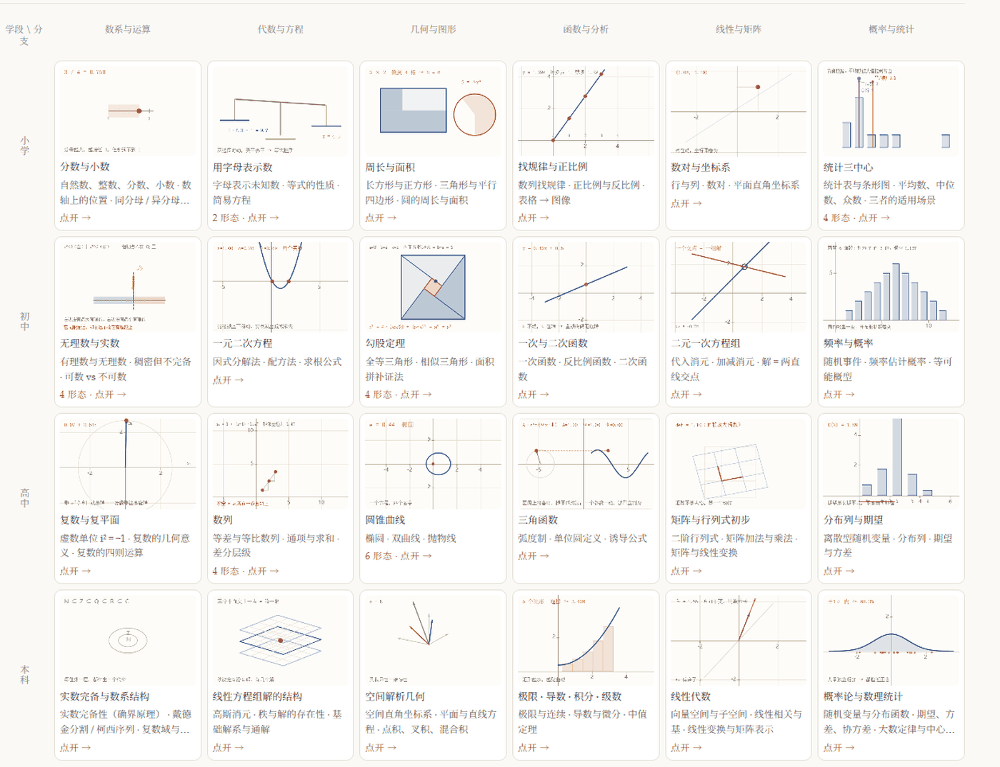
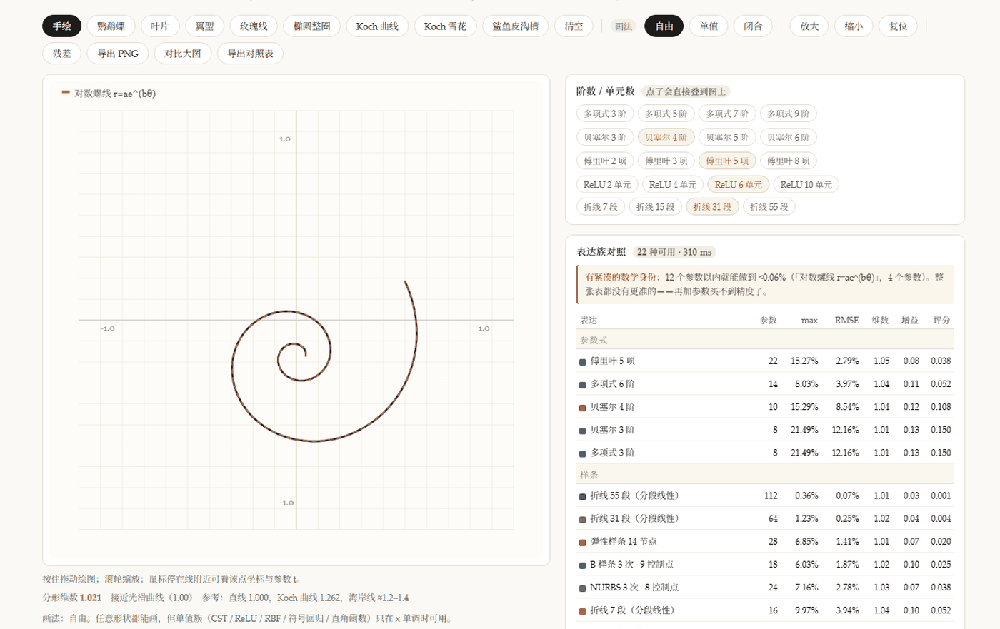

<div align="center">

# Math Map

by shenhunyan（神魂魇）

**A prerequisite graph of mathematics — 24 course cells, 124 knowledge points, 166 catalogue entries.**
Each cell carries a textbook-level definition, a citation to the exact chapter, and a live visual you can drag.

[](https://doi.org/10.5281/zenodo.24246636)

[**Open it →**](https://shenhunyan.github.io/math-map/) · [中文说明](#中文)

[](https://shenhunyan.github.io/math-map/math-map.html)

</div>

---

## What it is

Most math resources are organised as lists — by grade, by alphabet, by topic.
This one is organised by **dependency**: what must come before what, and what can be skipped.

When a student fails at conic sections, the problem is almost never conic sections. It is usually completing-the-square, or the distance formula, or the very idea of a locus. No textbook index will tell you that. A dependency graph will.

## What's different

| | Khan Academy | Wikipedia | 3Blue1Brown | **Math Map** |
|---|---|---|---|---|
| Structure | Grade × subject | Alphabetical | One topic at a time | **Prerequisite DAG** |
| Answers "what next?" | By grade | No | No | **By dependency** |
| Depth | Video | Article | Intuition | **Definition + citation + interactive** |
| Can you see the whole? | No | No | No | **Yes — 166 cells in one view** |

## What's inside

| Module | What it does | Count |
|---|---|---|
| **[Math Map](math-map.html)** | The whole territory. 11 views: course order, structure (degree × variables), operators, geometry (C×M), group theory, physics, number systems, history. Every cell opens into a draggable visual. | 24 cells · 124 points · 166 entries |
| **[Variations](variations.html)** | Every algebraic transformation, closed under composition. 13 equivalence operators applied to 192 seed forms → 1814 concrete variants, plus 66 operator chains and 51 named error patterns. | 1814 variants |
| **[Fitting Lab](fitting-lab.html)** | Draw a curve by hand; get back every mathematical language that can describe it — conic, polar, Bézier, NURBS, Fourier, Chebyshev, spline, RBF, symbolic regression — ranked by parsimony, not just fit. | 35 families |
| **[Diagnose](diagnose.html)** | 12 questions to locate which cell you're actually stuck in. Uses knowledge-space theory: if you can do B and B requires A, then you can do A. Two inference rules collapse 2²⁴ possibilities into a handful of questions. | 124 items · 12 questions |

Everything is a **single HTML file, zero dependencies, works offline**. No build step, no CDN, no tracking, no server.



## How the structure was built

**1. The structure is argued, not scraped.**
Every prerequisite edge was decided by asking "can a student learn B without A?" — and then checked by an independent reviewer. Three cells turned out to be *parallel* rather than sequential (conic sections: ellipse/hyperbola/parabola don't depend on each other), and one edge was reversed after review. That kind of judgement is the actual content here.

**2. It refuses to draw what can't be drawn.**
Number theory is deliberately absent as a matrix. Class groups, Galois groups, étale cohomology — these have no picture. Forcing them into a grid of "degree × dimension" would be dishonest. The map says so explicitly rather than padding cells.

## Contributing

The highest-value contribution right now is **upper-division and graduate mathematics** — the map currently stops at undergraduate. Differential geometry, algebraic topology, commutative algebra, representation theory, measure theory are all thin or missing.

You do not need to read 360KB of JavaScript to contribute. See **[CONTRIBUTING.md](CONTRIBUTING.md)** — adding a cell means editing one JSON object and writing one definition.

For anything else: open an issue. Corrections to prerequisite edges are especially welcome — that is where the real errors hide.

## Citation

If you use this in teaching, research, or a syllabus, please cite the DOI.

```bibtex
@misc{mathmap2026,
  title     = {Math Map: A prerequisite graph of K--16 mathematics},
  author    = {shenhunyan (神魂魇)},
  year      = {2026},
  publisher = {Zenodo},
  version   = {v1.5.1},
  doi       = {10.5281/zenodo.24246637},
  url       = {https://doi.org/10.5281/zenodo.24246637}
}
```

Two DOIs, as Zenodo does it:

- **`10.5281/zenodo.24246636`** — the concept DOI, always resolves to the newest version. Use this on a CV or a syllabus.
- **`10.5281/zenodo.24246637`** — the version DOI, frozen to v1.5.1. Use this when you need to cite exactly what you read.

## License

Split deliberately, because code and content need different protections:

- **Code** (HTML, CSS, JavaScript) — [MIT](LICENSE). Take it, fork it, build a product on it.
- **Content** (definitions, prerequisite structure, variation catalogue, table data) — [CC BY-SA 4.0](LICENSE-CONTENT). Use it, but credit it, and keep derivatives open.

The point of the split: you should be free to *build with* this, but not free to *enclose* it.

---

<a id="中文"></a>

## 中文

**数学地图**：一张从数数到概型的数学先修关系图。

24 个课程格、124 个知识点、166 个目录条目，每一格都有教材级定义、章节出处，和一个可以拖着动的图。

**为什么做这个**：现在的数学资源大多按年级、字母或主题排列，不写前置关系。学生卡住时，问题常常不在当前这一格，而在前面某一格。这张图把前置关系画出来。

**四个模块**：数学地图（全局结构）／变式全集（1814 个等价变形）／拟合实验室（一条曲线的 35 种写法）／诊断（12 题定位你卡在哪）。

**全部是单文件 HTML，零依赖，离线可用。** 没有构建步骤、没有 CDN、没有追踪、没有服务器。

**想一起做**：现在最缺的是本科高年级以上的内容——微分几何、代数拓扑、交换代数、表示论、测度论，要么很薄要么没有。加一格不需要读 36 万字符的代码，只要改一个 JSON 对象、写一段定义，见 [CONTRIBUTING.md](CONTRIBUTING.md)。

**协议**：代码 MIT，内容 CC BY-SA 4.0。你可以拿它去做产品，但不能把它圈起来。
